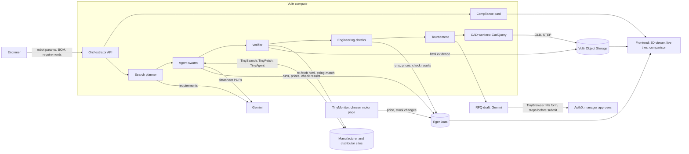

# Architecture

How the AI Robot Redesign Engine is put together. For the plan, demo script, milestones and team split, see [HANDOFF-v2.md](HANDOFF-v2.md). For policy facts, prize rules and TinyFish limits, see [HANDOFF.md](HANDOFF.md) (v1). For Entire commands, see [ENTIRE.md](ENTIRE.md).

## 1. Overview

An engineer has a robot whose drive motor must be replaced to meet US sourcing rules. The system:

1. shows **why** the part has to go: a compliance card (FCC coverage, domestic-content % against the 65% and 75% lines, the US final-assembly requirement) and a **separate** supply-risk flag (for example NdFeB magnets)
2. sends a **TinyFish agent swarm** to find real NEMA-frame replacement motors on live manufacturer and distributor websites, extract their specs, and verify origin and price against the source page
3. runs **deterministic engineering checks** (torque, speed, voltage, fit) and labels each candidate Rejected / Review / Pass\*
4. **regenerates the robot's CAD** in CadQuery: a new motor mounting bracket sized to the chosen motor, exported as GLB for the browser and STEP for engineers
5. runs a small **tournament** of 2–3 designs (lowest cost, best performance, US-first) and shows them side by side in 3D
6. drafts an RFQ for the chosen supplier and holds it for approval

Hackathon scope: one small wheeled robot that we model ourselves, and one subsystem (drive motor + bracket). This is a parametric template, not general editing of uploaded CAD files.

## 2. Diagram



## 3. Components

| # | Component | What it does | Deterministic or LLM | Owner |
|---|---|---|---|---|
| 1 | Robot model | Parametric CadQuery robot (base plate, wheels, motor mounts, electronics box) plus its BOM and requirements (mass, wheel radius, gear ratio, top speed, bus voltage, chassis envelope). | Deterministic | CAD |
| 2 | Compliance card | Checks FCC coverage, computes domestic % by component cost (unknown origin = foreign), shows the US final-assembly requirement, and flags supply risks on a separate track. | Deterministic | Engineering + data |
| 3 | Search planner | Turns the motor requirements into search queries and target sites. Seeded with 2–3 pre-identified real motors. | Gemini | Agents |
| 4 | Agent swarm | TinySearch + TinyFetch for broad discovery; TinyAgent for product pages and datasheets, returning the motor `output_schema`; live `streaming_url` tiles. | TinyFish | Agents |
| 5 | Datasheet reader | Reads datasheet PDFs and spec-table images when the product page lacks specs, and returns strict JSON. | Gemini (multimodal) | Agents |
| 6 | Verifier | Fetches the source page again and string-matches origin, price and NEMA frame against the html. Saves the html as evidence. | Deterministic | Agents |
| 7 | Engineering checks | Torque, speed, voltage and fit checks (§5) give Rejected / Review / Pass\*, plus a fit badge (`drop_in` / `close` / `needs_review`) and a spec comparison table. | Deterministic | Engineering + data |
| 8 | Tournament | Picks the best passing candidate for each objective: lowest cost, best performance, US-first. | Deterministic | Engineering + data |
| 9 | CAD workers | Regenerate the bracket and assembly for each design using the NEMA lookup table, then export GLB and STEP. One job per design, run in parallel. | Deterministic (CadQuery) | CAD |
| 10 | Writer | Fit explanations, the design comparison write-up and the RFQ draft. Numbers are passed in, never computed. | Gemini | Agents |
| 11 | RFQ flow | TinyBrowser + Playwright fills one supplier's quote form and stops before submitting. Auth0 approval is required to send. | TinyFish + Auth0 | Agents |
| 12 | Frontend | Compliance card, live agent tiles, check results table, 3D viewer with before/after slider, design tabs, Tiger Data panels. | n/a | Frontend + infra |

## 4. Data flow and schemas

**Robot requirements (input)**

| Field | Type | Notes |
|---|---|---|
| `mass_kg` | number | robot mass including payload |
| `wheel_radius_m` | number | |
| `n_drive_motors` | int | |
| `gear_ratio` | number | `G` |
| `efficiency` | number | drivetrain `η` |
| `crr` | number | rolling resistance |
| `max_slope_deg` | number | `θ` |
| `accel_mps2` | number | target acceleration `a` |
| `v_max_mps` | number | top speed |
| `bus_voltage_v` | number | |
| `envelope_mm` | number | space available for motor + bracket |
| `safety_factor` | number | about 1.5 |

**BOM row (input)**

| Field | Type | Notes |
|---|---|---|
| `part` | string | |
| `category` | string | motor, gearbox, encoder, battery, compute, sensor, frame and so on |
| `qty` | int | |
| `unit_cost_usd` | decimal | |
| `origin` | ISO country code or `unknown` | `unknown` counts as foreign; Canadian parts count as foreign |
| `supply_risk` | string? | for example `ndfeb_magnets`. Shown separately; does not change domestic % |

**Agent `output_schema` (one per candidate motor)**

A run that reports `COMPLETED` has not necessarily met its goal, so every result carries its own status. Data fields are optional so the agent doesn't fill unreachable ones with placeholders.

```json
{
  "status": "success | blocked | not_found | auth_required | incomplete",
  "reason": "string",
  "manufacturer": "string?",
  "part_number": "string?",
  "nema_frame": "string? (17 | 23 | 34)",
  "body_length_mm": "number?",
  "rated_torque_nm": "number?",
  "rated_speed_rpm": "number?",
  "voltage_v": "number?",
  "shaft_diameter_mm": "number?",
  "price_usd": "number?",
  "lead_time_days": "number?",
  "country_of_origin": "string?",
  "origin_quote": "string? (exact text from the page)",
  "product_url": "string?",
  "datasheet_url": "string?"
}
```

**Verifier statuses:** `verified`, `price_mismatch`, `origin_not_found`, `frame_mismatch`, `blocked`, `rejected`. Only `verified` candidates reach the engineering checks.

**Check result (per candidate):** `verdict` (`rejected | review | pass`), `fit` (`drop_in | close | needs_review`), and one row per check with `value`, `threshold`, `pass` and source links.

**Design variant (per tournament entry):** `design_id`, `objective` (`cost | performance | us_first`), `motor` (part number), `cost_usd`, `domestic_pct`, `glb_url`, `step_url`.

**Tiger Data**

- `agent_runs` (hypertable): `time`, `run_id`, `site`, `product`, `status`, `duration_s`, `steps`.
- `site_success_hourly` (continuous aggregate over `agent_runs`): powers the "success rate by site" panel, which is also evidence that the agents hold up on live websites.
- `price_observations` (hypertable): `time`, `part_number`, `supplier`, `price_usd`, `lead_time_days`, `origin`, `run_id`. Filled by repeated runs and TinyMonitor events.
- `check_results` (hypertable): `time`, `design_id`, `candidate`, `check`, `value`, `threshold`, `pass`. The audit trail behind each verdict.
- `design_variants` (regular table in the same database): the design variant fields above.

## 5. Engineering checks and CAD

**Checks** (all code; symbols from the requirements table):

| Check | Pass if |
|---|---|
| Torque | `r·m·(g·(Crr·cosθ + sinθ) + a) / (n·G·η) · SF ≤ rated_torque_nm` |
| Speed | `(rated_speed_rpm / G) · 2πr / 60 ≥ v_max` |
| Voltage | `voltage_v` matches `bus_voltage_v` (or is within the driver's supported range) |
| Fit | `body_length_mm + bracket thickness + clearance ≤ envelope_mm`, and `nema_frame` is in the lookup table |

**NEMA lookup table.** Typical values. Check each one against a real vendor drawing before building.

| Frame | Bolt-hole spacing (square) | Pilot diameter | Common shaft diameter |
|---|---|---|---|
| NEMA 17 | 31.0 mm | 22.0 mm | 5 mm |
| NEMA 23 | 47.14 mm | 38.1 mm | 6.35 mm or 8 mm |
| NEMA 34 | 69.6 mm | 73.0 mm | 9.5 / 12.7 / 14 mm |

**CAD functions** (CadQuery):

- `robot(params)`: the full assembly
- `motor(frame, body_len)`: a simple motor body from the NEMA table
- `bracket(frame, body_len, clearance)`: bolt spacing and pilot hole from the NEMA table; width from the frame; depth and position from `body_len`

Export: `cq.Assembly` to **GLB** for the viewer and **STEP** for the engineering export. The viewer (`<model-viewer>` or three.js) highlights the changed bracket and has a before/after slider.

## 6. Hard rules

1. The LLM never does arithmetic. All costs, percentages, checks and optimization are plain code.
2. Pass/fail comes from code checks and documented specs, never from an LLM's judgment.
3. Unknown origin counts as foreign. Allied content does not count, so Canadian parts are foreign.
4. Compliance and supply risk are separate. A US-made motor with foreign magnets still counts as domestic under the component test (confirm with counsel before stating it on stage).
5. A domestic end product must also be manufactured in the US. The compliance card says so whenever the robot is built elsewhere.
6. Every number in the UI links to its source. Nothing unverified reaches the checks.
7. Bolt patterns come from the NEMA lookup table, not from an LLM reading drawings.
8. No RFQ is submitted without Auth0 approval. One honest identity on real vendor sites; no fake personas.
9. The UI says "not legal advice" and "Pass\* = passes the checks we implemented, not engineering certification". The COTS question is shown as "flag for counsel".
10. No API keys or TinyFish credentials in prompts, because Entire session transcripts are pushed with the code.

## 7. Where each sponsor fits

| Sponsor | Where it runs | Where it is deliberately not used |
|---|---|---|
| TinyFish | TinySearch + TinyFetch for discovery; TinyAgent for product pages and datasheets with live tiles; TinyFetch html for verification; TinyBrowser for the RFQ form; TinyMonitor on the chosen motor's page | Broad discovery doesn't use Agent runs (cost and concurrency) |
| Gemini | Search planning; multimodal datasheet reading with strict JSON; long-context comparison of 3–5 datasheets; fit explanations, comparison write-up, RFQ draft | Arithmetic, pass/fail verdicts, origin verification, bolt patterns |
| Vultr | Orchestrator API (FastAPI) and workers in Docker (CadQuery/OCCT image); tournament designs as parallel CAD jobs; Object Storage for GLB/STEP files, datasheets and html evidence | n/a |
| Tiger Data | Hypertables for agent runs, prices and check results; continuous aggregate for site success rate; relational `design_variants` in the same database | n/a |
| Auth0 | Auth0 for AI Agents: manager approval before the RFQ is submitted; roles (engineer drafts, manager approves) | n/a |
| Entire | Trails per feature with review agents, overnight session handoffs, Brain for key decisions, graph search with measured token savings | n/a |
| GoDaddy | Live domain hosting the demo | n/a |

## 8. Limits and fallbacks

| Limit | How we handle it |
|---|---|
| About 2 concurrent TinyFish Agent runs and 5 Browser sessions on standard accounts | Queue runs with `/run-batch`. Ask the booth for a hackathon increase. Otherwise fill the tile wall with Browser sessions and cached replays, and say which tiles are live. |
| No CAPTCHA solving | Mark the site `blocked` and move on. Prefer sites with no bot wall (test in hour one). |
| `max_steps` needs beta access | Use `max_duration_seconds` (GA) as the run limit. |
| No screenshots | Store the captured `html` as evidence and use it for the verifier string-match. |
| File upload in TinyAgent is unclear | Use TinyBrowser + Playwright `setInputFiles`. |
| Datasheet dimensions misread | Only frame size, body length and ratings come from the web; bolt patterns come from the NEMA table. Mismatches go to Review. |
| The swarm comes up empty on demo day | 2–3 real motors are pre-identified and seeded into the planner. |
| CadQuery install pain | Run it in a Docker image on Vultr, so nobody installs OCCT locally. |
| Live websites fail during the demo | Pre-run and cache demo inputs; record a backup video. |

## 9. Repo layout

Stack: FastAPI (Python 3.12, uv) orchestrator, a CadQuery worker in its own Docker image, a Vite + React + TypeScript frontend, and Tiger Data (TimescaleDB). Owners are numbered as in the team split in HANDOFF-v2.md.

| Path | Owner | Contents |
|---|---|---|
| `backend/app/schemas.py` | all | Pydantic versions of the §4 contracts. Change these and §4 together. |
| `backend/app/api/routes.py` | all | `/api/robot`, `/api/compliance`, `/api/candidates/seed`, `/api/checks`, `/api/runs`, `/api/designs` |
| `backend/app/agents/` | 2 | `swarm.py`, `verifier.py`, `datasheet.py`, `rfq.py` |
| `backend/app/engineering/` | 3 | `nema.py`, `checks.py`, `compliance.py`, `tournament.py` |
| `backend/app/db/` | 3 | Tiger Data connection, Vultr Object Storage (S3) client |
| `cad/cad_worker/` | 1 | `robot.py` (`robot`, `motor`, `bracket`), `export.py` (GLB + STEP), `server.py` (`POST /build`, port 8001) |
| `frontend/src/` | 4 | `api.ts`, `types.ts` (mirrors `schemas.py`), `components/` (ComplianceCard, AgentTiles, ChecksTable, ModelViewer, DesignTabs) |
| `db/schema.sql` | 3 | Hypertables, the continuous aggregate and `design_variants` from §4 |
| `data/` | 3 | `demo_robot.json` (requirements + BOM), `seed_motors.json` (2–3 real pre-identified motors) |
| `docker-compose.yml` | 4 | Local stack: `db`, `cad` and `backend` |

The NEMA table is in both `backend/app/engineering/nema.py` and `cad/cad_worker/nema.py`, so the CAD image doesn't depend on the backend. Keep the two in sync.
