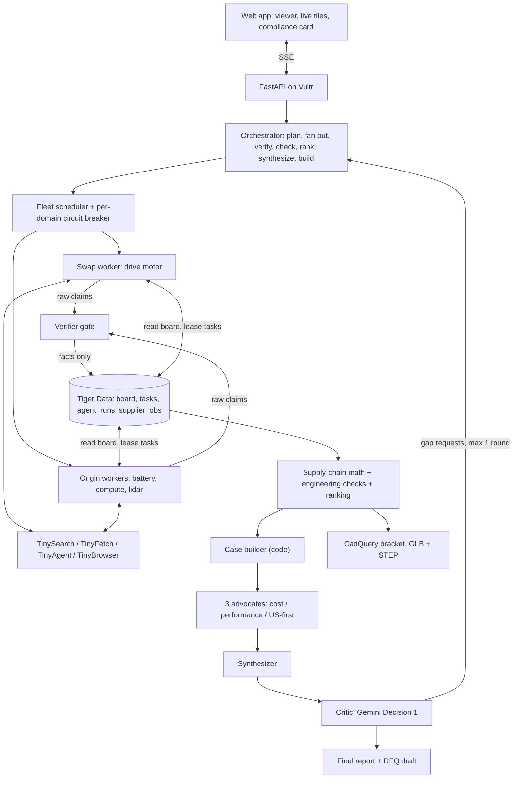

# Hack Western 13 handoff v3: build package (AI Robot Redesign Engine)

Written Sat Nov 21, 2026, ~5:15pm EST. Devpost deadline Sun Nov 22, 9am EST. Feature freeze 4am.
Build starts in the next session. This file wins over HANDOFF.md (v1) and HANDOFF-v2.md where
they disagree; v2 still holds the pitch, demo script and sponsor rules.

## 0. Read first (in this order)

| File | What | Who |
|---|---|---|
| `docs/design/architecture.html` | the diagram (open in a browser) | everyone |
| `docs/design/07-agent-architecture.md` | agent topology, blackboard SQL, Decision 1, synthesis + advocate contract | Tygo |
| `docs/design/04-architecture.md` | pipeline stages, data shapes, fleet scheduler, record/replay, events | Tygo, frontend |
| `docs/design/05-checks-spec.md` | units, torque/speed/voltage/fit rules, verdicts, evidence rules | checks owner |
| `docs/design/03-v2-review.md` | why the v2 schema/checks changed; real US motor targets | everyone |
| `docs/design/02-sourcing-factors.md` | tariffs, FCC test, rare earths, UFLPA, dates | Tygo, data owner |
| `docs/design/06-reading-tygo.md` | reading list for the coordination layer | Tygo |
| `docs/design/schemas/*.json` | TinyAgent output schema, advocate output schema | builders |
| `spikes/check_tf_schema.py` | checks an output_schema against TinyFish rules | Tygo |

## 1. The system in one paragraph

Code owns the control flow. An orchestrator fans out one worker per BOM line: a swap worker
hunts US-made NEMA replacements for the drive motor, and 2-3 origin workers try to prove where
current high-cost parts are made. Workers use free TinySearch/TinyFetch for discovery and
triage, and TinyAgent (live tiles) only where a page needs clicking. Raw claims go to a code
Verifier that re-fetches the page and matches quote and number; only it writes facts to a Tiger
Data blackboard that all workers read between runs. Deterministic code computes landed cost,
domestic %, risk flags and the engineering checks, ranks three designs, and CadQuery rebuilds the
motor bracket. Synthesis: a code case builder, three tightly scoped advocate calls, one writer,
and a Gemini Decision 1 critic that can send at most one round of gap requests back to the
orchestrator. No LLM produces a number, a verdict or an origin tier.

## 2. Locked decisions (all approved by Tygo)

1. Code-owned state machine; LLMs are functions. Workers are code loops, not LLM agents.
2. TRIAGE splits extraction: Fetch + Gemini for readable pages, TinyAgent only for interaction.
3. Verification: fresh TinyFetch html (`ttl=0`) + PDF text; agent html capture kept as provenance.
4. Units table in code (no `pint`); the agent returns value + unit as written.
5. Steppers allowed but capped at Review without verified torque at speed.
6. SSE to the UI; one FastAPI process, asyncio for I/O, process pool for CadQuery.
7. Record/replay client wraps every TinyFish and Gemini call from hour one (LIVE/REPLAY badge).
8. Origin tier decided by code rules; Decision 1 can only lower it.
9. Blackboard = `board` hypertable + `tasks` table; only the Verifier writes `kind='fact'`.
10. Site status lives only in `agent_runs`; orchestrator keeps an in-memory circuit breaker;
    `site_success_1h` continuous aggregate is a UI panel only.
11. Synthesis = case builder (code) + 3 scoped advocates (2 rounds) + one writer + Decision 1
    critic + one gap round. Advocate contract: 07 section 5.
12. Gemini Flash for planning, extraction and prose; Gemini Decision 1 for triage routing, run
    outcome, origin wording, rubric, gap choice.
13. Demo robot: ~5 kg, direct drive (G = 1), 60 mm wheels, NEMA servo baseline. Peak torque
    requirement 0.388 N·m per motor at 5 deg, 159 rpm at 1 m/s (computed, 05 section 2).

## 3. Contracts between owners (do not change without telling the others)

- TinyAgent output schema: `docs/design/schemas/motor_candidate.tinyfish.json`
  (passes `spikes/check_tf_schema.py`).
- Advocate output schema: `docs/design/schemas/advocate_output.schema.json`.
- Python data shapes: `Requirement`, `Source`, `Claim`, `OriginEvidence`, `Candidate`,
  `RunRecord` (04 section 4); `CheckResult` (05).
- SSE event types: `stage`, `run_started`, `run_streaming_url`, `run_progress`,
  `run_finished`, `claim_verified`, `claim_rejected`, `check_result`, `compliance`,
  `design_ready`, `advocate`, `synthesis`, `error` (04 section 8, plus the last three).
  Every event: `{type, job_id, ts, data}`. The UI is a pure function of the event log.
- SQL: 07 section 3 (`board`, `tasks`, `agent_runs`, `supplier_obs`, `site_success_1h`,
  `supplier_1h`). Untested; run it on Tiger Cloud first (needs TimescaleDB 2.13+).
- HTTP: `POST /jobs` (BOM + requirement + mode live|replay|mixed), `GET /jobs/{id}`,
  `GET /jobs/{id}/events` (SSE), `GET /designs/{id}/glb`, `GET /designs/{id}/step`.

## 4. Existing code on main vs v3 (teammates already scaffolded from v2)

`main` (PR #1 repo-setup, PR #2 cad-bracket) already has `backend/app/` (FastAPI, `schemas.py`,
`agents/{swarm,datasheet,verifier,rfq}.py` stubs, `engineering/{checks,compliance,nema,tournament}.py`),
`cad/cad_worker/` (parametric robot, NEMA bracket, GLB/STEP; better than `spikes/cad_spike.py`),
`db/schema.sql`, `frontend/` (Vite React), `docker-compose.yml`, `data/demo_robot.json`,
`data/seed_motors.json` (empty), and `docs/ARCHITECTURE.md` written against v2. Build on it; keep
its module and table names. Deltas to apply in the first build hour:

| Where | Today (v2) | Change to (v3) | Owner |
|---|---|---|---|
| `schemas.py` `MotorCandidate` | flat `rated_torque_nm`, `voltage_v`, `price_usd`... | mirror `schemas/motor_candidate.tinyfish.json`: `motor_type`, `specs[] {name, value, unit, at_speed_*, quote, source_url}`, `origin_source_url`; add `Claim`, `Source`, `OriginEvidence` (04 section 4) | 2 + 3 |
| `schemas.py` `RobotRequirements` | `envelope_mm`, one torque requirement | add `min_ground_clearance_mm`, `wheel_bore_mm`, `deck_thickness_mm`; keep `envelope_mm` as inboard room | 3 |
| `schemas.py` `BomRow` | `origin` string | add `origin_tier` (T1/T2/T3/rejected/none), `freight_usd`, `duty_usd`, `hts_code` | 2 + 3 |
| `engineering/checks.py` | single torque check, exact voltage match, no motor type, fit length only | rules in 05: units table, cont + peak torque, per-type speed/voltage, `fit_ground`, `fit_shaft`, real drop_in/close badge | 3 |
| `engineering/compliance.py` | unit cost only; note "COTS treatment: flag for counsel" | landed cost (freight + duty) per FAR 25.003; domestic only if origin tier T1/T2 and US; pass only if strictly > 65%; replace COTS note: FCC FAQ says COTS exception inapplicable (01) | 2 |
| `agents/swarm.py` | one `find_candidates()` | becomes `workers/` swap + origin workers driven by the orchestrator; add `orchestrator/`, `tfclient/` (record/replay), `synth/` (case builder, advocates, synthesizer, critic) under `backend/app/` | 2 |
| `agents/verifier.py` | stub | `classify_outcome`, `verify_claim`, origin tier rules (section 7) | 2 |
| `db/schema.sql` | `agent_runs`, `site_success_hourly`, `price_observations`, `check_results`, `design_variants` | add `board`, `tasks` (07 section 3); `agent_runs` + `job_id`, `product`, `live`, rename `status` -> `outcome` or keep and document; set `site_success_hourly` to `materialized_only = false` and use `sum(CASE ...)` if `FILTER` fails; add `origin_tier` to `price_observations` and a `supplier_1h` cagg on it | 2 |
| `data/seed_motors.json` | empty | Teknic ClearPath-SD NEMA 23, Moog SM23165D, Pittman (T3 example), real fields only | 3 |
| `docs/ARCHITECTURE.md` | v2 | banner added pointing here; fold v3 in when time allows | 2 |

Names in 07 map to existing ones: `site_success_1h` = `site_success_hourly`,
`supplier_obs` = `price_observations`.

## 5. Owners

| Owner | Area |
|---|---|
| 1 | CAD: robot + bracket in CadQuery (Python 3.12), GLB/STEP, viewer before/after |
| 2 (Tygo) | orchestrator, fleet, tfclient record/replay, workers, verifier, board/tasks, supply math, synthesis loop |
| 3 | checks + units, NEMA table with vendor drawing URLs, demo BOM with real prices and origins, requirement, tariffs.yaml, entity lists |
| 4 | frontend (tiles via iframe of `streaming_url`, compliance card, design tabs with advocate text), Vultr deploy, domain, video, Devpost, social post |

## 6. Build order and milestones (EST)

| By | Done means |
|---|---|
| 8pm | Repo skeleton. tfclient with record/replay. One live TinyAgent run on a Teknic page with our schema; Verifier confirms at least one quote. CAD: bracket from hard-coded NEMA 23 numbers in the viewer. |
| 11pm | One job end to end on the motor: discover → triage → extract → verify → checks → rank → GLB in viewer, SSE tiles live. Deployed on Vultr. |
| 1:30am | board + tasks on Tiger Data, 2 origin workers, circuit breaker, compliance card, success-by-site panel. |
| 3:30am | case builder, advocates round 1, synthesizer, RFQ draft. Then, if time: cross-exam, critic, gap round. |
| 4am | FEATURE FREEZE. 4-8am: record replay fixtures for the demo, backup video, Devpost text, social post tagging TinyFish. |

Cut order if behind (first cut first): advocates round 2 → critic + gap round → TinyMonitor →
TinyBrowser RFQ form → origin workers (keep motor only) → supplier_1h. Never cut: live agents on
real sites, verifier, code checks, regenerated bracket.

## 7. Tygo's first chunk (hands-on flow applies)

Scaffold inside the existing backend: `backend/app/tfclient/` (record/replay), `backend/app/agents/verifier.py`,
`backend/app/orchestrator/` skeleton with fake workers; apply the `schemas.py` deltas from section 4 first.
Core for Tygo to write (failing tests left by the agent):
- `classify_outcome(run) -> Outcome`: COMPLETED with `status != success`, all-null data,
  "access denied"/CAPTCHA text, or FAILED map to `blocked | not_found | auth_required |
  incomplete | error`; only a clean result is `success`.
- `verify_claim(claim, html_or_pdf_text) -> Claim`: normalize whitespace/commas, find the quote,
  check the number in the quote equals `raw_value`, set `verified` and `verify_method`.
Test cases to include: a COMPLETED run with all nulls; a quote present but number differs
(promo vs regular price); a quote split across tags; "Designed in USA" must not become T1/T2.

## 8. Environment and secrets

- Python 3.12 for anything importing CadQuery (`pip install cadquery` worked, 2.8.0; `cad/` has its own Dockerfile). The Hermes
  sandbox's `/tmp` is a 512 MB tmpfs: create venvs under `/home/pn` there.
- Keys only in a gitignored `.env`: `TINYFISH_API_KEY`, `GEMINI_API_KEY`, Tiger connection
  string, Vultr. Never in prompts or goals (AGENTS.md: session transcripts are pushed).
- TinyFish free daily allowance: 12,000 Search, 1,000 Fetch URLs. Agent concurrency per account
  (assume 2 until the booth answers). `max_steps` is beta; use `max_duration_seconds`.
- Pushing: the sandbox token may not push to Kingsolima/HackWestern-2026; Tygo pushes from host.
- Commits: no AI co-author lines (AGENTS.md).

## 9. Still open (ask in person)

- TinyFish booth: concurrency bump for our accounts; `max_steps` beta today?
- Organizers: can one team win more than one MLH prize?
- Demo BOM: must be a covered device and produce an honest before/after domestic %.

## 10. Known-good targets for the demo (pre-identify, verify again in hour one)

- Teknic ClearPath-SD, NEMA 23/34 integrated servo, from $265, "New York manufacturing plant"
  (T2). https://teknic.com/products/clearpath-brushless-dc-servo-motors/clearpath-sd/
- Moog Animatics SmartMotor SM23165D, "produced in our Murphy, NC facility" (model-specific).
  https://animatics.com/news-and-events/moog-animatics-lead-time-improvement
- Pittman NEMA 23 brushless: HQ address only (T3), the verifier's "Review" example.
- Distributors: DigiKey (Cloudflare) and Mouser (Akamai) blocked a plain headless browser; test
  through TinyFish stealth + US proxy before relying on them. Mouser lists Country of Origin per
  SKU when reachable.

## 11. Kickoff prompt for the next session

> Load the `agentic-coding-workflow` and `hackathon-ideation` skills. Read
> `docs/HANDOFF-v3.md`, then `docs/design/07-agent-architecture.md` and `04-architecture.md`.
> Design is approved. `git fetch`, branch from `origin/main` (teammates' scaffold is there; see
> section 4 for the deltas). Start Tygo's first chunk (section 7): scaffold tfclient record/replay,
> verifier and orchestrator skeleton, leave failing tests for `classify_outcome` and
> `verify_claim` for me to write. Python 3.12 venv under /home/pn.
