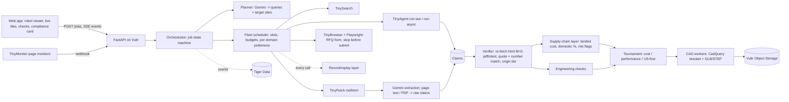

# 04 Architecture (v2 final draft for sign-off)

Status: approved. Agent topology, board and synthesis are superseded by 07-agent-architecture.md and architecture.html (v3.2). Originally: design checkpoint, Sat Nov 21 ~3:30pm EST. Supersedes v1 ARCHITECTURE notes and the
agent schema in HANDOFF-v2 section 4. Check rules live in `05-checks-spec.md`.
TinyFish facts below were read from docs.tinyfish.ai/llms-full.txt on Nov 21, 2026.

## 1. Principle

Code owns the control flow; agents and LLMs are workers called at fixed points.
- TinyFish = the hands (find, read, click). Gemini = the reader/writer (PDF and page
  extraction, explanations). Python = the boss (what runs next, what counts, every number).
- A fact reaches the checks only as a verified `Claim` with a quote and a source.
- Nothing an LLM says is a pass/fail, a price, or a percentage.

## 2. System diagram



Owners: UI + infra (4), CAD (1), checks + data (3), everything in the middle from Orchestrator
to the supply-chain layer, plus Tiger Data events (2, Tygo).

## 3. The job state machine (Tygo)

```
CREATED -> COMPLIANCE_BASELINE -> PLAN -> DISCOVER -> TRIAGE -> EXTRACT -> VERIFY
        -> CHECK -> RANK -> BUILD -> REPORT -> DONE
any stage -> DEGRADED (continue with what verified) | FAILED (no verified candidate at all)
```

| Stage | Does | Tool | Exit condition |
|---|---|---|---|
| COMPLIANCE_BASELINE | domestic %, prong-1 note, supply-risk flags for the current BOM | code | always |
| PLAN | requirements -> 6-10 queries + seed domains | Gemini (JSON) | queries validated by code |
| DISCOVER | run queries; keep URLs on candidate domains | TinySearch (free) | <= N candidate URLs |
| TRIAGE | fetch candidates, classify each URL: `readable` (specs on page), `needs_interaction` (tabs, configurator, datasheet hunt), `dead` | TinyFetch markdown (free, 10 URLs/call) + code rules | every URL classified |
| EXTRACT | readable -> Gemini on fetched text/PDF; needs_interaction -> TinyAgent with schema | Gemini / TinyAgent | per-candidate `RunResult` |
| VERIFY | independent re-fetch and match; origin tier | TinyFetch html ttl=0, pdftotext | each claim verified or rejected |
| CHECK | torque, speed, voltage, fit | code | per-candidate verdict |
| RANK | 3 objectives over Pass* (and Review if none) | code | up to 3 designs |
| BUILD | bracket + assembly per design | CadQuery workers | GLB + STEP in storage |
| REPORT | explanations, comparison, RFQ draft | Gemini (numbers passed in) | text with cited numbers |

Why TRIAGE matters for the prize: it is the "smart use of TinyFish" story. Free Search and
Fetch do the wide net; paid Agent steps go only where a page needs clicking. Tiles still show
real agents, because origin hunts and datasheet hunts are multi-page jobs.

## 4. Data shapes

```python
class Requirement(BaseModel):          # from the robot spec, owner 3
    mass_kg: float; wheel_radius_m: float; n_drive: int; gear_ratio: float; eta: float
    crr: float; slope_deg: float; accel_mps2: float; v_max_mps: float; v_bus: float
    safety_factor: float; frame_allowed: list[str]; inboard_room_mm: float
    min_ground_clearance_mm: float; wheel_bore_mm: float

class Source(BaseModel):
    url: str; kind: Literal["page", "pdf"]; fetched_at: datetime
    html_key: str | None               # object-storage key of the captured html/pdf
    via: Literal["tinyfetch", "tinyagent", "replay"]

class Claim(BaseModel):                # one fact, never a bare number
    candidate_id: str
    field: str                         # e.g. "continuous_torque", "country_of_origin"
    raw_value: str; raw_unit: str | None; quote: str
    source: Source
    si_value: float | None = None      # filled by units.py, never by an LLM
    extracted_by: Literal["tinyagent", "gemini_text", "gemini_vision"]
    verified: bool = False
    verify_method: Literal["html_quote", "pdf_text", "none"] = "none"

class OriginEvidence(BaseModel):
    country: str | None
    tier: Literal["T1", "T2", "T3", "rejected", "none"]
    claim_id: str | None

class Candidate(BaseModel):
    id: str; manufacturer: str | None; part_number: str | None
    motor_type: Literal["servo_integrated", "bldc", "stepper", "brushed_dc", "unknown"]
    nema_frame: Literal["17", "23", "34", "other"] | None
    claims: list[Claim]; origin: OriginEvidence
    status: Literal["found", "blocked", "not_found", "auth_required", "incomplete"]

class RunRecord(BaseModel):            # one per external call; goes to Tiger Data agent_runs
    run_id: str; job_id: str; product: Literal["search", "fetch", "agent", "browser", "monitor", "gemini"]
    site: str; started_at: datetime; duration_s: float
    tf_status: str | None              # PENDING/RUNNING/COMPLETED/FAILED/CANCELLED
    outcome: Literal["success", "blocked", "not_found", "auth_required", "incomplete", "error"]
    reason: str; steps: int | None; cost_usd_est: float | None; live: bool
```

`motor_candidate.tinyfish.json` (in `schemas/`) is the TinyAgent `output_schema`. It passes the
TinyFish keyword rules (checked by `spikes/check_tf_schema.py`; the checker also catches a
planted `additionalProperties` and a type array). Specs are a flat array of
`{name, value, unit, at_speed_value, at_speed_unit, quote, source_url}` so each one maps 1:1 to
a `Claim`. All data fields are `nullable` and listed in `required`, so null means "looked, not
found" and the agent is never pushed into placeholders.

## 5. Fleet scheduler (Tygo)

- One `asyncio.Semaphore` per product, sized from config: `AGENT_SLOTS` (booth answer, default
  2), `BROWSER_SLOTS` (5), Fetch batches of 10 URLs, Search respecting `Retry-After`.
- Per-domain politeness: at most 1 concurrent agent run per domain (docs: TinyFish does not
  throttle by domain).
- Budgets per job, enforced in code: max agent runs (8), `agent_config.max_duration_seconds`
  (180), estimated spend cap. Not `max_steps` (beta, 403 without it).
- Retry policy: `blocked` -> one retry with `browser_profile=stealth` + `proxy_config` US.
  Never re-submit a run that errored or timed out on our side before `GET /v1/runs/{id}` shows it
  terminal (it may still be executing). CAPTCHA -> mark blocked, move on.
- Outcome classification in code: `COMPLETED` plus `status != success` in the result, or all data
  fields null, counts as a failure.
- Agent calls use `/run-sse` for on-screen tiles (`STREAMING_URL` event -> iframe; the URL is safe
  to expose, the key stays server-side), `/run-async` for overflow. `capture_config: {html: true}`
  on every agent run for provenance (screenshots have not shipped).

## 6. Record/replay layer (Tygo, build early)

Wrap every TinyFish and Gemini call in one client that can `record` (save request hash ->
response + captured html to storage), `replay`, or `live`. Mode per job: `live`, `replay`,
`mixed` (live up to the slot limit, replay the rest). Every tile and RunRecord carries `live:
bool` and the UI shows a LIVE / REPLAY badge. This is the concurrency fallback, the demo safety
net and the test fixture source in one piece.

## 7. Supply-chain layer (Tygo)

Pure functions over verified claims plus small sourced data files:
- `landed_cost(part, origin, qty)`: price + freight + duty. Duty from `data/tariffs.yaml`, one
  row per (HTS code, origin) for the 2-3 codes the demo uses, each with layer, rate, source URL,
  date checked. CAD->USD from a dated Bank of Canada rate. Unknown HTS -> "duty unknown" flag,
  not a guess.
- `domestic_share(bom)`: domestic if origin tier is T1 or T2 and country == US; else foreign.
  Cost = landed cost (FAR 25.003: duty and freight included). Pass only if share > 0.65 (and show
  the 0.75 line). Prong 1 (US final assembly) is a separate boolean from user input.
- `risk_flags(candidate)`: rare-earth magnets (any PM motor; supply risk track, not compliance),
  UFLPA high-priority inputs (lithium, aluminum, copper), name match against `data/lists/`
  (FCC Covered List entities, DoD 1260H, UFLPA Entity List) with list date.
- Output feeds the compliance card and the tournament objectives.

## 8. Event stream to the UI

`GET /jobs/{id}/events` (SSE). Every event: `{type, job_id, ts, data}`.
Types: `stage`, `run_started`, `run_streaming_url`, `run_progress`, `run_finished`,
`claim_verified`, `claim_rejected`, `check_result`, `compliance`, `design_ready`, `advocate`,
`synthesis`, `error`.
The UI is a pure function of the event log, so a replayed job renders identically.

## 9. Sponsor tech map (what each is for)

| Tech | Use | Tier |
|---|---|---|
| TinySearch + TinyFetch | discovery, triage, verification re-fetch | must |
| TinyAgent | multi-page extraction, origin + datasheet hunts, live tiles | must |
| Gemini | search planning, PDF/page extraction to strict JSON, explanations, RFQ text | must |
| Vultr | API + CAD workers in Docker (Python 3.12), Object Storage for html/pdf/GLB/STEP | should |
| Tiger Data | `agent_runs`, `price_observations`, `check_results` hypertables; `site_success_hourly` continuous aggregate | should |
| TinyBrowser | RFQ form fill on one supplier, stop before submit | could |
| TinyMonitor | page monitor on chosen motors, `purpose` = price/stock change, webhook -> price_observations (needs public HTTPS on Vultr) | could |
| TinySet | optional wide-net "US-made NEMA motors" table ($0.10/complete row, 3 runs at once) | could |
| Auth0 | manager approval gate before "send RFQ" | could |

## 10. Decisions (recommendation first)

1. Control flow: deterministic state machine in Python, LLMs as functions. Alt: a planner LLM
   choosing tools. Rejected: harder to bound cost, MAST-style coordination failures, worse demo
   determinism.
2. Extraction split by TRIAGE: Fetch+Gemini for readable pages, TinyAgent only where interaction
   is needed. Alt: TinyAgent for every page. Rejected: paid steps for reads, slower, fewer slots
   for the pages that need them.
3. Verification: independent TinyFetch html (ttl=0) + PDF text, plus the agent's own html
   capture kept as provenance. Alt: trust agent output. Rejected: COMPLETED != correct.
4. Units: our own ~12-entry conversion table with tests. Alt: `pint`. Rejected: extra dependency
   for a dozen units; an explicit table is easier to audit on stage.
5. Steppers: allowed, but best verdict is Review unless torque at operating speed is verified.
   Alt: exclude steppers. Rejected: the baseline robot may use one and the UI should explain why.
6. Transport: SSE from FastAPI. Alt: WebSockets. Rejected: one-way stream is all we need.
7. Workers: one FastAPI process, asyncio for I/O, a process pool for CadQuery. Alt: Redis/Celery.
   Rejected: more moving parts than 13 hours allow. On stage say "workers on Vultr", which is true.
8. Record/replay at the client boundary from hour one. Alt: backup video only. Rejected: video
   cannot survive judge questions.
9. Origin tiers decided by code rules (quote on product page / datasheet naming the model = T1,
   company page naming a US plant for the product line = T2, HQ address only = T3, marketing
   phrases rejected). Gemini may suggest, code decides.

## 11. Open questions

- Booth: agent concurrency for our accounts; is `max_steps` beta grantable today.
- Organizers: more than one MLH prize per team?
- Demo baseline motor and BOM (owner 3): must be a covered device, ~5 kg, direct drive.
